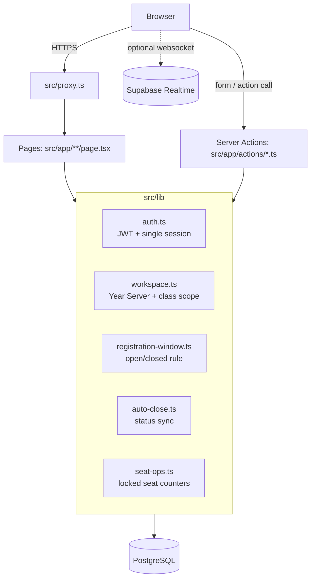

# Electify — Architecture

A focused summary for developers. The full reference, including the ER diagram,
is in [PROJECT_MAINTENANCE_MANUAL.md](PROJECT_MAINTENANCE_MANUAL.md) §4 and §7.
Older design notes and ADRs live in [`docs/`](../docs/) (see the
[ADRs](../docs/decisions/) for the reasoning behind row locking, Year Server
isolation, the single-session sentinel and the Next.js 16 proxy).

## Shape of the system

One Next.js 16 application (App Router) running on Node. It renders pages with
Server Components, performs every mutation in Server Actions, and talks to
PostgreSQL through Drizzle ORM over a shared `pg` pool. There is no separate API
service. Supabase Realtime is an optional refresh signal.

## Layers and rules

| Layer | Location | Rule |
| --- | --- | --- |
| Routing guard | `src/proxy.ts` | Redirects only (no data access). Not the security boundary. |
| Pages | `src/app/**` | Load data on the server; call `getSession()` and, for staff, `requirePageWorkspace()`. |
| Mutations | `src/app/actions/*.ts` | Re-check session, role and workspace in every action. Return `{ success, error }`-style results. |
| Domain logic | `src/lib/*.ts` | Single home for each rule (window, seats, scope). Reuse, do not re-implement. |
| Data | `src/lib/db/schema.ts` | Source of truth for tables; migrations in `drizzle/`. |
| Client components | `*-client.tsx`, `src/components/**` | UI state only; never trusted for authorization or time. |

## Concurrency model

- Seat changes lock the affected `electives` rows with `SELECT … FOR UPDATE`
  (in id order, to avoid deadlocks) inside one transaction
  (`src/lib/seat-ops.ts`, `src/app/actions/register.ts`).
- `takeSeat` counts the real `CONFIRMED` rows and rewrites
  `available_seats`/`is_full`, so drifted counters heal themselves.
- Receipt numbers are allocated under
  `pg_advisory_xact_lock(hashtext('electify_receipt_number'))`, so two
  finalizations cannot receive the same sequence number.

## Time model

- `open_date`/`close_date` are `timestamp` without time zone, compared as
  instants on the server. Keep the server TZ fixed (UTC on Vercel).
- Display uses `APP_TIME_ZONE = "Asia/Kolkata"` (`src/lib/format.ts`).
- The server clock is authoritative: `getRegistrationWindow()` is evaluated at
  request time in every action, never with a client-supplied time.
- Status sync (`syncExpiredRegistrationEvents`) is lazy — triggered by student
  event loading, registration and the live monitor; there is no scheduler.

## Isolation model

- **Year Server**: staff pick an `academic_sessions` row after sign-in; pages
  listed by `isSessionScopedPath()` require one.
- **Classes**: tutors see only classes in `tutor_sections`; coordinators their
  department; admins everything. A forged `electify_active_section` cookie for
  a foreign class is ignored.
- **Students**: see only events that target their section
  (`src/lib/student-events.ts`); crafted event IDs in URLs are ignored.

## Where to add things

| Change | Put it in |
| --- | --- |
| New staff page | `src/app/faculty/(authenticated)/<name>/page.tsx` + menu entry in `src/components/layout/nav-config.ts` + server checks |
| New mutation | A function in the relevant `src/app/actions/*.ts` with session/role/workspace checks |
| New table/column | `schema.ts` + numbered SQL in `drizzle/` + rollback in `drizzle/rollback/` + npm script |
| New business rule | `src/lib/` module with unit tests in `tests/` |
