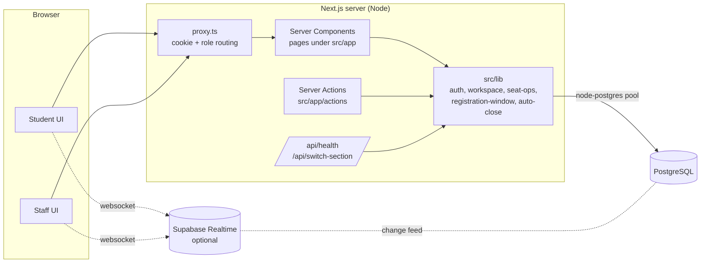
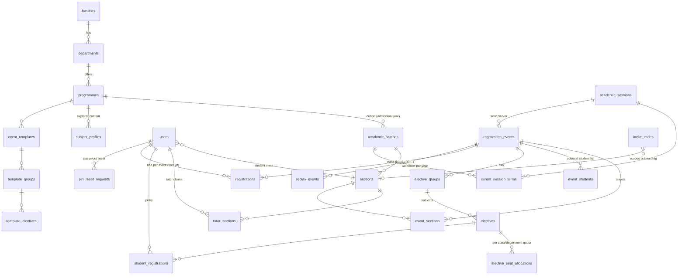
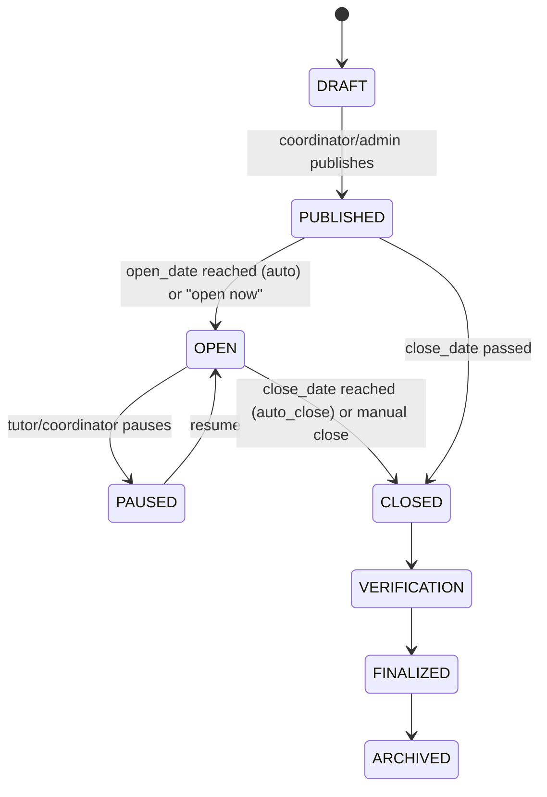

# Electify — Project Maintenance Manual

> Audience: the next developer or maintainer of this repository.
> Every statement here was checked against the source on **23 October 2026**
> (commit `db3b7d0` plus the working tree). Where something could not be
> verified it is marked **Unverified**. When the code and this manual disagree,
> the code wins — please fix the manual.

Related focused guides: [ARCHITECTURE.md](ARCHITECTURE.md) ·
[DEVELOPMENT_SETUP.md](DEVELOPMENT_SETUP.md) · [DEPLOYMENT.md](DEPLOYMENT.md) ·
[TESTING.md](TESTING.md) · [REPOSITORY_CLEANUP_REPORT.md](REPOSITORY_CLEANUP_REPORT.md)

---

## Contents

1. [Project overview](#1-project-overview)
2. [Technology stack](#2-technology-stack)
3. [Repository map](#3-repository-map)
4. [Architecture](#4-architecture)
5. [Local setup](#5-local-setup)
6. [Environment variables](#6-environment-variables)
7. [Database and data model](#7-database-and-data-model)
8. [Authentication, roles and authorization](#8-authentication-roles-and-authorization)
9. [Core workflows](#9-core-workflows)
10. [Integrations](#10-integrations)
11. [Testing](#11-testing)
12. [Deployment](#12-deployment)
13. [Troubleshooting](#13-troubleshooting)
14. [Safe maintenance procedures](#14-safe-maintenance-procedures)
15. [Security and privacy](#15-security-and-privacy)
16. [Current status and technical debt](#16-current-status-and-technical-debt)
17. [Quick reference](#17-quick-reference)

---

## 1. Project overview

Electify is a web application for running **elective (optional subject)
registration** for university classes. It was built as an MCA mini project for
SRM Institute of Science and Technology.

- **Students** sign in with their register number, browse the subjects offered
  to their class, pick one subject per elective group while a registration
  window is open, may change or cancel picks while editing is allowed, and
  finally lock their registration to obtain a numbered receipt and PDF.
- **Staff** (class tutors, course coordinators, system administrators) prepare
  the academic structure, create registration events with groups, subjects and
  seat limits, open/pause/close windows, watch live seat counts, and export
  reports.
- Seats are first-come, first-served. There is **no waitlist** (it was removed;
  see `drizzle/0004_remove_waitlist.sql`). Seat changes run inside PostgreSQL
  transactions with row locks so a seat cannot be sold twice.
- Staff work inside an explicitly chosen **Year Server** (an academic year,
  table `academic_sessions`); data from other years is not shown.

## 2. Technology stack

Versions are from `package.json` (`^` ranges; the lockfile pins exact versions).

| Layer | Technology | Where |
| --- | --- | --- |
| Framework | Next.js 16.2 (App Router, Server Components, Server Actions) | `src/app/` |
| UI | React 19.2, Tailwind CSS 4, Base UI / shadcn-style components, Lucide icons, Motion | `src/components/` |
| Language | TypeScript 5 (strict type-check via `npm run typecheck`) | `tsconfig.json` |
| Database | PostgreSQL (local, or hosted Supabase) via `pg` (node-postgres) | `src/lib/db/index.ts` |
| ORM | Drizzle ORM 0.45 + drizzle-kit 0.31 | `src/lib/db/schema.ts`, `drizzle.config.ts` |
| Auth | `jose` HS256 JWT in an httpOnly cookie, `bcryptjs` cost 12 | `src/lib/auth.ts`, `src/proxy.ts` |
| Validation | Zod 4 | server actions |
| Realtime (optional) | `@supabase/supabase-js` Realtime channels | `src/lib/supabase.ts` |
| PDF | jsPDF + jspdf-autotable (client side) | `src/lib/brand-pdf.ts` and report clients |
| Tests | Node test runner via `tsx --test`; Playwright 1.64 + axe-core | `tests/`, `tests/e2e/` |
| Runtime | Node `>=20.9.0` (`engines`), `.nvmrc` = 24 | |

## 3. Repository map

Only tracked, meaningful paths are listed.

```text
.
├── .github/workflows/ci.yml   CI: install, lint, unit tests, type-check, build (no DB)
├── .claude/launch.json        Local dev-server launcher config for Claude Code (npm run dev, port 3000)
├── .agents/skills/, skills-lock.json   Third-party Supabase agent-skill text (tooling only, not used by the app)
├── src/
│   ├── proxy.ts               Next.js 16 routing proxy (cookie check, role redirects)
│   ├── app/
│   │   ├── login/, join/      Sign-in; class sign-up with a tutor-issued code
│   │   ├── dashboard/         Student portal (electives, subjects, my-registration, success)
│   │   ├── countdown/         Waiting page before a window opens
│   │   ├── faculty/(authenticated)/   Staff portal (one folder per page, see §8)
│   │   ├── actions/           Server Actions (all mutations live here)
│   │   ├── api/health/        Health check + first-admin bootstrap (see §15)
│   │   ├── api/switch-section/  Sets the tutor's active class cookie
│   │   ├── maintenance/       Shown when system_settings.maintenance_mode is on
│   │   ├── presentation/      Redirects to public/presentation.html
│   │   └── dev/               Component galleries; call notFound() in production
│   ├── components/            UI building blocks (layout/nav-config.ts holds the staff menus)
│   ├── lib/                   Domain logic (see §4.3)
│   │   └── db/                schema.ts, index.ts (pool + auto-heal), seed.ts, reset.ts, srm-data.ts
│   └── types/                 Shared TypeScript contracts
├── drizzle/                   SQL migrations 0000–0007, meta/ journal, rollback/ for 0004–0006
├── scripts/                   One-off maintenance scripts (see §14.4)
├── tests/                     Integration tests (*.test.ts) + helpers/world.ts fixtures
│   └── e2e/                   Playwright specs, global-setup, synthetic fixtures
├── public/                    Static assets, brand files, presentation.html
├── docs/                      Older design docs and ADRs (some superseded, see banners)
├── documentation/             This manual, focused guides, project report material
│   └── final-report/          Academic report generator (Python) and outputs
├── artifacts/presentation/    Project presentation (.pptx) and exported material
├── README.md, CONTRIBUTING.md, SECURITY.md, WINDOWS_SETUP.md
└── drizzle.config.ts, next.config.ts, playwright.config.ts, eslint.config.mjs, components.json
```

Git-ignored working folders you may see locally: `node_modules/`, `.next/`,
`.next-*/` (isolated builds), `scratch/`, `test-results/`, `playwright-report/`,
`.env*` (except `.env.example`).

## 4. Architecture

### 4.1 System context



There is no separate backend service. All data access happens on the Next.js
server through Drizzle; the browser never talks to the database directly.
Realtime is a best-effort refresh signal only; pages also re-fetch on their own.

### 4.2 Request flow

1. `src/proxy.ts` runs for every non-API, non-static path. It verifies the
   `electify_session` JWT signature, sends students away from `/faculty/*` and
   staff away from `/dashboard/*`, restricts `/faculty/audit` to
   `SYSTEM_ADMIN`, and adds an `x-electify-pathname` header for layouts.
2. Layouts and pages call `getSession()` (`src/lib/auth.ts`), which also checks
   the single-login sentinel (`users.current_session_id`) and `is_active`.
3. Staff pages resolve the **workspace** (`requirePageWorkspace` /
   `requireStaffWorkspace` in `src/lib/workspace.ts`): chosen Year Server +
   the classes the user may see.
4. Mutations go through Server Actions in `src/app/actions/*.ts`. Each action
   re-checks the session and role and scopes queries to the workspace. **The
   proxy is a convenience redirect, not the security boundary.**

### 4.3 Key modules

| Module | Responsibility |
| --- | --- |
| `src/lib/auth.ts` | Sign/verify JWT (2 h), session cookie, single-session revocation, production secret guard |
| `src/lib/workspace.ts` | Staff scope (role, department, tutor classes), Year Server cookie, class guard (`assertClass`, `assertEventInWorkspace`) |
| `src/lib/registration-window.ts` | The one rule for "is the window open?" (`getRegistrationWindow`, `openNowPatch`) |
| `src/lib/auto-close.ts` | `syncExpiredRegistrationEvents()` keeps event status in line with the clock |
| `src/lib/seat-ops.ts` | `takeSeat`, `releaseSeat`, `confirmedCount` — locked seat counter updates |
| `src/app/actions/register.ts` | Student register / change / cancel / finalize, receipt numbering |
| `src/lib/student-events.ts` | Which events a student may see |
| `src/lib/db/index.ts` | Shared `pg` pool and `ensureDatabaseReady()` additive schema auto-heal |
| `src/lib/supabase.ts` | Optional realtime client; `realtimeConfigured` flag |
| `src/lib/password-policy.ts` | Password rules (min 8, letter + number, blocks trivial defaults) |

## 5. Local setup

Full step-by-step guide: [DEVELOPMENT_SETUP.md](DEVELOPMENT_SETUP.md)
(Windows: [../WINDOWS_SETUP.md](../WINDOWS_SETUP.md)). Short version:

```bash
nvm use                      # Node 24 per .nvmrc (>=20.9 required, 22+ for npm test globs)
npm ci
cp .env.example .env.local   # read by Next.js and the --env-file scripts
cp .env.example .env         # read by drizzle-kit, db:seed, db:reset
# edit both: point DATABASE_URL/DIRECT_URL at a LOCAL database, set JWT_SECRET
npm run db:push              # create tables on a NEW, EMPTY database
npm run db:seed              # hierarchy + development accounts
npm run dev                  # http://localhost:3000
```

## 6. Environment variables

All names below are read somewhere in `src/`, `scripts/`, `tests/` or config.
Template: [`.env.example`](../.env.example). Never commit real values.

| Variable | Required | Read by | Purpose |
| --- | --- | --- | --- |
| `DATABASE_URL` | yes | app pool, scripts, tests, drizzle-kit fallback | PostgreSQL connection. SSL is enabled automatically unless the URL contains `localhost`/`127.0.0.1`. |
| `DIRECT_URL` | recommended | `drizzle.config.ts`, `db:reset` | Direct (non-pooled) connection for schema tools; falls back to `DATABASE_URL`. |
| `JWT_SECRET` | yes (prod) | `src/lib/auth.ts`, `src/proxy.ts` | HMAC key for session JWTs. 32+ random chars. Production throws if missing or equal to the fallback. |
| `SETUP_SECRET` | prod bootstrap | `/api/health` | Authorizes `?setup=1` admin creation in production. |
| `INITIAL_ADMIN_PASSWORD` | prod bootstrap | `/api/health` | Password for the bootstrap root admin; required in production. |
| `NEXT_PUBLIC_APP_URL` | optional | `src/app/layout.tsx` | Canonical URL for metadata/social previews. |
| `VERCEL_PROJECT_PRODUCTION_URL` | auto (Vercel) | `src/app/layout.tsx` | Fallback canonical host, set by Vercel. |
| `NEXT_PUBLIC_SUPABASE_URL` | optional | `src/lib/supabase.ts` | Realtime project URL. Leave empty to disable realtime. |
| `NEXT_PUBLIC_SUPABASE_PUBLISHABLE_KEY` / `NEXT_PUBLIC_SUPABASE_ANON_KEY` | optional | `src/lib/supabase.ts` | Public realtime key (publishable preferred). Public by design — see §15. |
| `NEXT_DIST_DIR` | optional | `next.config.ts` | Alternate build directory (e2e server, side-by-side builds). |
| `E2E_DATABASE_URL`, `E2E_PORT` | e2e only | `tests/e2e/fixtures/constants.ts` | Defaults `postgresql://localhost:5432/electify_e2e`, port `3210`. |
| `CI`, `NODE_ENV` | platform | Playwright, Next.js | Standard meaning. |

## 7. Database and data model

### 7.1 Schema source of truth

`src/lib/db/schema.ts` defines 27 tables. The hosted development database
was observed (read-only, 23 Oct 2026) to contain **40** tables: the 27 above
plus `academic_reconciliation_archive` and 12 `re_*` tables that are **not
defined anywhere in this repository**. Treat those as belonging to another
system; do not drop them (see §14.2 about `db:push`).

### 7.2 Entity–relationship overview

Columns omitted for readability; arrows point from child to parent.



Standalone tables: `audit_logs`, `login_attempts`, `system_settings`
(single row `id = 'system'`: `maintenance_mode`, `max_tutor_sections` default 10).

### 7.3 Important columns and rules

- `electives.max_seats` / `available_seats` / `is_full` — the seat counter.
  `takeSeat` derives availability from the real number of `CONFIRMED`
  `student_registrations` rows (`confirmedCount`) and rewrites the counter, so
  a drifted counter self-corrects on the next registration for that subject.
- `registration_events.status`: `DRAFT | PUBLISHED | OPEN | PAUSED | CLOSED |
  VERIFICATION | FINALIZED | ARCHIVED` (ACTIVE is also accepted as a legacy
  open state). `allow_editing`, `auto_close` booleans; `open_date`/`close_date`
  are `timestamp` (no time zone) — keep the server TZ fixed (UTC on Vercel).
- `registrations` (one per student per event): `status` enum
  (`NOT_REGISTERED | CONFIRMED | CANCELLED | RESET_BY_COORDINATOR`),
  `receipt_number`, snapshot, `is_finalized` (added by migration 0007).
- `student_registrations.status`: `CONFIRMED` or `CANCELLED` (one row per pick).

### 7.4 Migrations — read before touching the schema

| File | How it is applied | Rollback |
| --- | --- | --- |
| `0000`–`0002` | generated by drizzle-kit | — |
| `0003_careful_cancellation.sql` | hand-written; apply with `scripts/db/apply-sql.ts` | — |
| `0004_remove_waitlist.sql` | `npm run db:migrate:remove-waitlist` | `drizzle/rollback/0004_*.down.sql` |
| `0005_subject_profiles.sql` | `npm run db:migrate:subject-profiles` | `drizzle/rollback/0005_*.down.sql` |
| `0006_academic_sessions.sql` | `npm run db:migrate:academic-sessions` | `drizzle/rollback/0006_*.down.sql` |
| `0007_registration_finalization.sql` | **no npm script**: `npx tsx --env-file=.env.local scripts/db/apply-sql.ts drizzle/0007_registration_finalization.sql` | **none** |

Facts that bite:

- `drizzle/meta/_journal.json` only records 0000–0002, so **`npm run
  db:migrate` (`drizzle-kit migrate`) is not a working path** for an existing
  database. New databases are created with `npm run db:push`; existing ones
  receive the hand-written SQL files explicitly.
- `scripts/db/apply-sql.ts` runs one file in a single transaction and applies
  to whatever `DATABASE_URL` is in `.env.local`. **Check the host first.**
- `ensureDatabaseReady()` (`src/lib/db/index.ts`, called by `/api/health`)
  additively creates a few older columns/tables if missing. It does **not**
  cover `is_finalized` (0007) or the academic-session tables (0006).

## 8. Authentication, roles and authorization

### 8.1 Sign-in and sessions

- Students sign in with **register number + password**; staff with **e-mail +
  password** (`src/app/actions/auth.ts`). Passwords are bcrypt (cost 12).
- 5 failed attempts lock the identifier for 15 minutes (`login_attempts`).
- On success a HS256 JWT valid for **2 hours** is stored in the httpOnly
  cookie `electify_session`. A new sign-in writes a new
  `users.current_session_id`, which revokes older sessions on other devices.
- Other cookies: `electify_academic_session` (chosen Year Server),
  `electify_active_section` (tutor's active class; ignored if it names a class
  the tutor does not own), `electify_active_workspace`.
- Students created by a tutor, or using a legacy PIN/default password, must set
  a new password at next sign-in. Tutor-authorized resets use `pin_reset_requests`.

### 8.2 Roles

| Role | Scope | Menu (from `src/components/layout/nav-config.ts`) |
| --- | --- | --- |
| `SYSTEM_ADMIN` | Everything. The root admin `electify@srmist.edu.in` (`ROOT_ADMIN_EMAIL`) cannot be deleted, deactivated or demoted. | Dashboard, Live monitor, Replay, Events, Academic Timeline, Departments, Templates, User access, Invite codes, Audit logs, Database, Settings |
| `COURSE_COORDINATOR` | Their department | Dashboard, Live window/monitor, Electives & baskets, Events, Academic Timeline, Departments & classes, Students, Reports, class pages, Invite codes, Templates |
| `CLASS_TUTOR` | Classes they claimed in their department (max `system_settings.max_tutor_sections`, default 10) | Dashboard, Live window, Electives & baskets, Students, Reports, Approvals, Replay |
| `STUDENT` | Their own class's events | `/dashboard/*`, `/countdown` |

The menu is only navigation. Authorization is enforced in Server Actions and
page loaders via `getSession()` + `loadStaffScope()`/`assertClass()`/
`assertEventInWorkspace()`. When adding a feature, **always** add the server
check; never rely on hiding a menu item.

### 8.3 Year Servers

After staff sign-in the app shows `/faculty/session-select`; the choice is
stored in `electify_academic_session`. `isSessionScopedPath()` lists the pages
that require one. `listSessionsForScope()` currently returns **all** sessions to
every staff role (changed deliberately in commit `db3b7d0`); class visibility
is still limited by role/department/tutor assignment.

## 9. Core workflows

### 9.1 Event lifecycle



`syncExpiredRegistrationEvents()` (`src/lib/auto-close.ts`) is called lazily —
from student event loading, registration, and the monitor — and:
1. closes `OPEN/ACTIVE/PAUSED/PUBLISHED` events whose `close_date` passed (if `auto_close`);
2. moves `OPEN` events whose `open_date` is still in the future back to `PUBLISHED`;
3. opens `PUBLISHED` events whose `open_date` has arrived.

There is **no cron job**; status changes happen on the next request that calls
the sync. Independently, `getRegistrationWindow()` compares the clock with
`open_date`/`close_date` on every check, so a student can never register
before the opening time even if a status is stale.

### 9.2 Student registration

```mermaid
sequenceDiagram
  actor St as Student
  participant UI as /dashboard/electives
  participant A as registerElectives()
  participant DB as PostgreSQL
  St->>UI: pick one subject per group
  UI->>A: submit picks
  A->>A: getSession, window open?, class targeted?
  A->>DB: BEGIN; lock elective rows (FOR UPDATE)
  A->>DB: takeSeat: count CONFIRMED, check max_seats
  A->>DB: insert student_registrations + registrations (no receipt yet)
  A->>DB: replay_events, audit_logs; COMMIT
  St->>UI: change / cancel while allow_editing
  St->>A: finalizeStudentRegistration()
  A->>DB: advisory lock → receipt ELC-<year>-<ODD|EVEN>-<seq>, snapshot, is_finalized = true
```

- A receipt number and PDF exist **only after finalization**. Finalization is
  also applied lazily once the window has closed.
- A tutor unlocking a student clears finalization so they can edit again.
- Change/cancel release the old seat with `releaseSeat` in the same transaction.

### 9.3 Staff workflows (summary)

- **Academic structure**: faculties → departments → programmes → batches →
  sections (`/faculty/departments`, admin/coordinator).
- **Onboarding**: staff join with role-scoped invite codes (`/faculty/invites`);
  students join their class with a tutor's signup code at `/join`, or are
  imported/created by their tutor.
- **Events**: build manually or from a template (`/faculty/events`,
  `/faculty/templates`), targeted at one or more classes, with groups,
  subjects and seat quotas.
- **Live**: `/faculty/window` (pause/resume/close), `/faculty/monitor`,
  `/faculty/replay` (ordered timeline of picks).
- **Reports**: `/faculty/reports` (coordinator), `/faculty/tutor-reports`
  (tutor), PDF/CSV export in the browser.
- **Database page** (`/faculty/database`, admin): read/maintenance views — read
  `src/app/actions/database.ts` before using it on real data.

## 10. Integrations

| Integration | Status | Notes |
| --- | --- | --- |
| PostgreSQL | required | Local or hosted Supabase. Pool max 10. Non-local connections use SSL with `rejectUnauthorized: false`. |
| Supabase Realtime | optional | Disabled automatically when URL/key are empty (`realtimeConfigured`). Channels: presence `online-users`, `postgres_changes` on `student_registrations` (section page) and electives (picker). On the hosted dev DB only `electives` is in the `supabase_realtime` publication and `anon` has no table grants, so change events may not arrive — **Unverified end to end**; pages still refresh on their own. |
| Vercel | intended host | No `vercel.json`. `VERCEL_PROJECT_PRODUCTION_URL` is used if present. |
| GitHub Actions | CI | `.github/workflows/ci.yml` (see §11). |

No e-mail, SMS, payment or third-party identity provider is integrated.

## 11. Testing

Details: [TESTING.md](TESTING.md).

| Command | What | Needs DB | Last observed result (23 Oct 2026) |
| --- | --- | --- | --- |
| `npm run lint` | ESLint on `src` | no | 0 errors, 1 warning (`workspace.ts` unused `scope`) |
| `npm run typecheck` | `tsc --noEmit` | no | pass |
| `npm run test:unit` | 15 pure tests | no | 15/15 pass |
| `npm test` | 145 integration tests | **yes — writes rows** | 141 pass, 4 fail (run against a local DB) |
| `npm run test:e2e` | Playwright, isolated server + throwaway `electify_e2e` | local PostgreSQL | see [TESTING.md](TESTING.md) |
| `npm run build` | production build | no | pass |

> ⚠️ `npm test` loads **`.env.local`**. If that file points at a hosted database,
> the tests write (and then delete) fixture rows there. Override it:
> `DATABASE_URL=postgresql://localhost:5432/electify_test DIRECT_URL=$DATABASE_URL npm test`
> (environment variables set on the command line take precedence over `--env-file`).

The 4 failing integration tests have stale expectations, not product bugs:
receipts are now issued at finalization (2 tests), Year Server listing now
returns all sessions (1 test), and the auto-open sync turns a PUBLISHED event
with a past `open_date` into OPEN (1 test). See [TESTING.md](TESTING.md#known-failures).

CI runs lint, unit tests, type-check and build. It does **not** run the
integration or e2e suites (they need PostgreSQL).

## 12. Deployment

Details: [DEPLOYMENT.md](DEPLOYMENT.md). Summary: Vercel (or any Node host)
running `npm run build && npm start`; set the variables from §6; create the
schema with `db:push` on a new database, then apply 0003–0007 as needed;
bootstrap the root admin with `/api/health?setup=1` and an `x-setup-secret`
header; keep the server time zone at UTC.

## 13. Troubleshooting

| Symptom | Likely cause | Fix |
| --- | --- | --- |
| `getaddrinfo ENOTFOUND` / timeout | DB host unreachable, Supabase project paused | Check host, network, project status. |
| `FATAL: JWT_SECRET must be configured…` | Production without a real secret | Set `JWT_SECRET` (32+ random chars). |
| Signed out every few minutes | Signed in elsewhere (single-session) or 2 h expiry | Expected behaviour. |
| "Too many failed attempts" | 5 failures → 15 min lock | Wait, or clear the row in `login_attempts` on a dev DB. |
| `column "is_finalized" does not exist` | Migration 0007 not applied | Apply `drizzle/0007_registration_finalization.sql` (§7.4). |
| Staff redirected to session-select repeatedly | No Year Server chosen / cookie cleared | Pick a year; check `academic_sessions` has rows. |
| Event stays PUBLISHED after open time | Nothing has called the sync yet | Any student/monitor request triggers it; windows still open by clock. |
| Realtime "Reconnecting" | Wrong URL/key, or realtime not wanted | Fix the keys or leave them empty to disable. |
| Seat counter shows more seats than max | Counter drift from direct DB edits | See §14.3. |
| Next build clashes with running dev server | Shared `.next` | `NEXT_DIST_DIR=.next-build npm run build`. |

## 14. Safe maintenance procedures

### 14.1 Before any database write

1. Print the target host without credentials, e.g.
   `node -e "console.log(new URL(process.env.DATABASE_URL).hostname)"` after loading the env file.
2. If it is not `localhost`, stop and confirm that this is intended.
3. Take a backup: `pg_dump "$DATABASE_URL" -Fc -f backup.dump`.

### 14.2 Dangerous commands

| Command | Danger |
| --- | --- |
| `npm run db:reset` | `DROP SCHEMA public CASCADE` on `DIRECT_URL`/`DATABASE_URL` from **`.env`**. No host check. Never run against a shared DB. |
| `npm run db:push` | drizzle-kit has no `tablesFilter`; on the hosted DB it would propose **dropping the 13 tables not in this schema** and any column drift. Only use on new/local databases and read every prompt. |
| `npm run db:migrate` | Journal covers only 0000–0002; unsafe/incorrect on existing DBs. |
| `npm run db:seed` | Inserts development accounts with known passwords. Local only. |
| `npm run db:clean`, `fix:passwords`, `scripts/*.ts` | One-off data scripts; read the source and target DB before running. |
| `npm test` | Writes fixture rows to whatever `DATABASE_URL` resolves to. |

### 14.3 Repairing seat counters

`takeSeat` rewrites a subject's counter from the real confirmed count on the
next registration. To repair all counters at once, review and run
`scripts/db/repair-elective-seat-allocations.sql` (read it first) on a backed-up
database. On 23 Oct 2026 the hosted dev DB had 3 events whose
`available_seats` exceeded `max_seats` and 2 subjects with 19 confirmed picks for
18 seats; this was caused outside the current app code and has **not** been
repaired (needs owner approval).

### 14.4 Scripts folder

| Script | Purpose |
| --- | --- |
| `scripts/db/apply-sql.ts` | Apply one SQL file in a transaction |
| `scripts/db/repair-elective-seat-allocations.sql` | Recompute seat allocations |
| `scripts/seed-subject-profiles.ts` | Subject explorer content (`db:seed:subjects`) |
| `scripts/cleanup-mock-data.ts` | Remove mock data (`db:clean`) |
| `scripts/fix-passwords.ts` | Re-hash legacy passwords (`fix:passwords`) |
| `scripts/seed-full-mca-classes.ts`, `setup-angel-multi-year-tutor.ts`, `fix-mca-genai.ts` | One-off data fixes for specific classes; not general tools |
| `scripts/brand/generate-brand-assets.ts` | Regenerate logo assets (`brand:generate`) |

### 14.5 Making changes

- Keep "window open" logic in `registration-window.ts` only.
- Keep seat counter writes in `seat-ops.ts` and inside a transaction.
- New schema: edit `schema.ts`, write a numbered SQL file in `drizzle/` and
  a rollback in `drizzle/rollback/`, add an npm script, update §7.4.
- Run lint, typecheck, unit, integration (local DB) and e2e before merging.

## 15. Security and privacy

- **Secrets**: no `.env` or key file has ever been committed (full-history scan,
  23 Oct 2026). Findings in tracked files are placeholders or test-only values.
- **Fallback JWT secret**: `auth.ts` and `proxy.ts` fall back to a hard-coded
  string when `JWT_SECRET` is unset. Production refuses to sign with it
  (`assertProductionSecret`), but the proxy would still *verify* with it.
  Always set `JWT_SECRET`.
- **Development credentials**: `src/lib/db/seed.ts` prints dev passwords; the
  health bootstrap falls back to `Admin@12345` outside production. They were
  verified **not** to work on the hosted dev DB. Never seed a public deployment.
- **`/api/health`** is public. It reports configuration booleans, DB latency,
  whether the root admin exists and raw DB error messages, and runs the schema
  auto-heal. With `?setup=1` it creates the root admin **without
  authentication when `NODE_ENV` is not `production`**. The production setup
  secret may be sent as `?secret=`, which can end up in access logs — prefer the
  `x-setup-secret` header.
- **TLS**: non-local DB connections disable certificate verification
  (`rejectUnauthorized: false`).
- **Supabase**: RLS is disabled on all public tables of the hosted dev DB, but
  `anon`/`authenticated` have no SELECT grants there (checked 23 Oct 2026), so
  the public key cannot read tables through the Data API. If grants are ever
  added, enable RLS first.
- **Personal data**: the app stores student names, register numbers and
  e-mails. `scripts/fix-mca-genai.ts` contains real-looking student names and
  e-mail addresses — review whether it belongs in a public repository.
- **Third-party documents**: `documentation/final-report/work/reference.docx`,
  `work/render/ref_render.docx` and `work/refmedia/` contain another team's
  report used as a formatting reference. They should not be in a public repo.
- Server-function argument logging is disabled in `next.config.ts` so dev logs
  do not print passwords.
- Report vulnerabilities as described in [../SECURITY.md](../SECURITY.md).

## 16. Current status and technical debt

| # | Item | Severity |
| --- | --- | --- |
| 1 | 4 integration tests have stale expectations (§11) | Medium |
| 2 | Hosted dev DB seat counters inconsistent (§14.3) | Medium |
| 3 | Migration tooling split: journal 0000–0002, hand-written 0003–0007, no script/rollback for 0007 | Medium |
| 4 | `db:reset`/`db:push`/`npm test` have no host guard | High (operational) |
| 5 | `/api/health` unauthenticated bootstrap outside production; error detail leakage | Medium |
| 6 | Realtime change feed likely inactive on hosted DB (publication/grants) | Low |
| 7 | Third-party report files and personal-style data tracked in a public repo | High (privacy/licensing) |
| 8 | No cron for status sync (lazy) | Low |
| 9 | Older docs in `docs/` partly superseded (banners added) | Low |
| 10 | Lint warning in `workspace.ts` (unused `scope` after db3b7d0) | Low |
| 11 | Large binary report intermediates tracked under `documentation/final-report/work/render/` | Low |

## 17. Quick reference

```bash
npm run dev                 # dev server :3000
npm run lint && npm run typecheck && npm run test:unit
DATABASE_URL=postgresql://localhost:5432/electify_test DIRECT_URL=postgresql://localhost:5432/electify_test npm test
npm run test:e2e            # local PostgreSQL required; recreates electify_e2e
NEXT_DIST_DIR=.next-build npm run build
npx tsx --env-file=.env.local scripts/db/apply-sql.ts drizzle/<file>.sql   # check host first
curl -s http://localhost:3000/api/health | jq .
```

| Thing | Value |
| --- | --- |
| Session cookie | `electify_session` (JWT HS256, 2 h) |
| Root admin | `electify@srmist.edu.in` (password never stored in the repo) |
| Receipt format | `ELC-<year>-<ODD\|EVEN>-<6-digit seq>` |
| Lockout | 5 attempts → 15 min |
| Tutor class limit | `system_settings.max_tutor_sections` (default 10) |
| Display time zone | Asia/Kolkata (`APP_TIME_ZONE`) |
